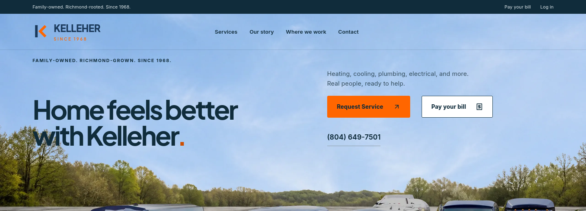
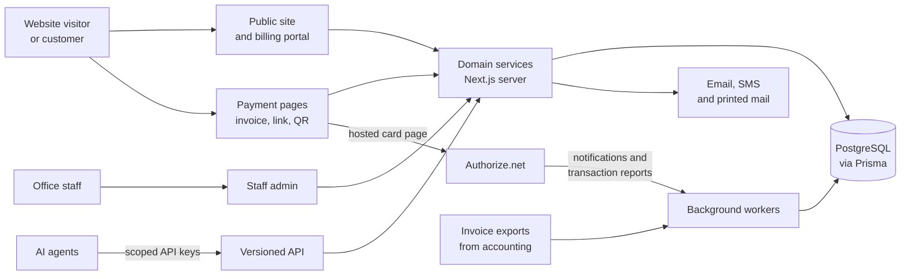
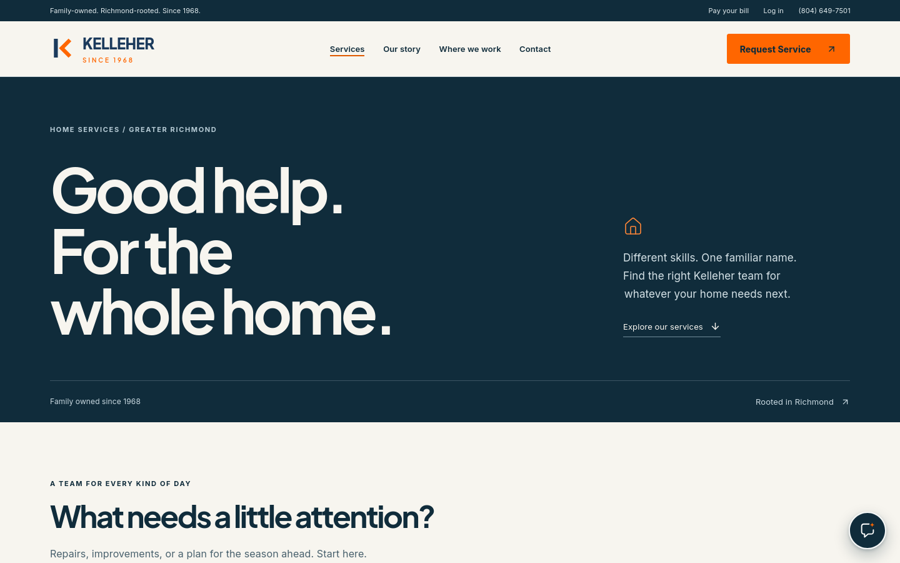

# Kelleher HVAC

**The public website, online bill pay and staff back office for a family-owned Richmond, Virginia home-services company: one Next.js platform that takes customers from a Google search to a paid invoice.**

Live: [kelleherhvac.com](https://kelleherhvac.com)

---

## What it is

Kelleher HVAC has served Richmond homes since 1968 with heating and cooling, heating oil, plumbing, electrical work and generators. This platform is the company's whole online presence and a growing share of its office work. It is the public website, the page where customers pay their bills, and the staff admin where the office sends invoices, follows up payments, runs mail campaigns and manages the site.

It runs in production on [HostKit](https://github.com/codeslayer44/hostkit-showcase), Emergent's in-house hosting platform. Customers never need an account to pay. Card details are entered only on the payment processor's own hosted page.

## Highlights

- **Online bill pay that the office can trust.** Customers pay by invoice number on the website, from a link in an email or text, or by scanning the QR code on a printed bill. The charge reaches Authorize.net under the real invoice number. The platform only marks a payment as received once the processor itself confirms it, through its notifications and a regular check of its transaction records. A browser landing on a "thank you" page proves nothing on its own.
- **Invoices flow in from the accounting system automatically.** Invoices exported from Kelleher's existing accounting system are picked up from a shared folder about every 15 minutes, read into structured records and published to a customer billing portal. Thousands of historical invoices were imported as well. Staff can then print an invoice with its own pay-by-QR code or send it electronically, and every route leads to the same online invoice and payment page.
- **A back office built around the money.** Staff get one page per customer, linked to their invoices, payments and past processor history; a "needs attention" queue for payments that need a person, such as an abandoned checkout, a refund or a settlement that never arrived; plain-English explanations of card declines, and automatic receipts. They also track recording each web payment in the accounting system, so nothing is entered twice or missed.
- **Direct-mail campaigns where every letter is checked before it posts.** Staff build maintenance-plan offer campaigns. Each household gets a personalised letter, printed and mailed through PostGrid, with a QR code that leads to its own offer page. Before a letter can be approved, the platform renders it, scans the QR code back out of the actual PDF and refuses the letter unless it matches that household's page exactly. An AI agent can prepare a mailing, but only a person can approve a live one.
- **A website rebuild that protected what the old site had earned in search.** The old WordPress site was replaced page for page, not just redesigned. An audit of all 222 URLs that Google Search Console knew about passes in full against production: old pages load or redirect to their new home. 24 old blog posts were recovered and restored at their original addresses. The site also has dedicated pages for its six main service areas, structured business data and a sitemap checked page by page.
- **An API that AI agents can work through.** A versioned API with 146 documented operations covers customers, sites, equipment, jobs, visits, follow-ups, parts, permits, offers and mailings. Each AI agent uses its own scoped, revocable key with specific permissions. The task guides agents read are checked against the same OpenAPI specification on every build.
- **AI assistants that can't see private data.** The staff Assistant, live in the admin, is a guide. It explains screens and opens the right page, and it has no access to customer, invoice or payment data at all. "Ask Kelleher", the website assistant, answers visitors using only what the public site already says and can hand them to the enquiry form; it is released behind a switch, ready to turn on. Website enquiries can include photos and are emailed to the office.

## The brief and the outcome

**What Kelleher needed.** A long-established family business with a dated WordPress website and invoices that were printed and posted by hand. It wanted customers to be able to pay their bills online in a way the office could match to the right invoice. Any change had to fit around the accounting and dispatch system the office already runs on, not replace it.

**What Emergent delivered.** Starting in March 2026, Emergent rebuilt the public website and then grew it, release by release, into the platform described here: customer and staff sign-in, online bill pay, invoice import and delivery, payment follow-up, campaign mail, an operations data model and API, and the two assistants. Fleet management started here too and has since moved to its own product, [FleetHarbor](https://github.com/codeslayer44/fleetharbor-showcase). The admin's Fleet link now opens FleetHarbor.

**What changed for Kelleher.**

- Customers pay any bill online, at any hour, without creating an account. They can get an emailed receipt, and the office sees the payment under the invoice number it already uses.
- Payments that need a person (an abandoned checkout, a failed settlement, a refund on a payment already recorded in the accounting system) show up in one queue for the office to work through.
- Invoices the accounting system already produces become online invoices with a pay link and QR code, with no retyping.
- The new website carries over the old site's pages and addresses, so links and search results keep working. It sends mail from the company's own domain with mail authentication in place (DKIM aligned, DMARC passing), and new enquiries, photos included, reach the right inboxes.
- Staff work in a single admin, with access set person by person.

### The wider engagement

Three smaller private repositories belong to the same client engagement. Each is described at its real stage.

| Project | What it is | Stage |
|---|---|---|
| **Technician iPhone app** | A Kelleher-branded app for field technicians. It is a SwiftUI shell that will embed the platform's own screens and add what a phone does natively: voice reports, photos and location as visit evidence. The platform side already has technician accounts with per-person access controls and an audit log, behind a switch. | Early development (9 commits). A simulator-only foundation with voice capture and an embedded preview. It does not connect to live data yet. |
| **Accounting data access** | Groundwork for reading business data from Kelleher's existing accounting system, read-only, so the platform can eventually work from the same records the office does. It is a one-time setup that checks before it changes anything, runs a dry run first and can undo only what it set up. | Built and tested in simulation (3 commits). Not yet in use. |
| **HVAC manual library** | A planned independent catalogue of HVAC equipment manuals. Once a technician identifies a unit, the service is meant to return the relevant manual pages and tables with exact citations, so diagnosis rests on the manufacturer's own documents. Kelleher will be its first user. | Specification and early research (8 commits). Implementation has not started. |

## Architecture

One Next.js application serves three faces from separate hostnames: the public site and billing portal, the open payment pages, and the staff admin. Each host only answers its own routes, and signed-in write requests that come from another website are refused. Every face calls the same domain services, so a payment, an invoice or a customer record has one implementation whether a customer, a staff member or an AI agent touches it.

Slow or outside-facing work runs in background workers that ship inside the same release: invoice import, processor reconciliation, receipt and payment-request delivery, and the mail queue. Each worker runs under a supervisor with a hard time limit and is safe to run again, so a run that is stopped partway through simply picks up next time.

A deeper walk-through is in [docs/architecture.md](docs/architecture.md).

## Engineering notes

**Money moves on evidence, not on page loads.** Every web payment is a record with an explicit set of allowed states (created, pending, held, accepted, settled, declined, refunded and so on). It can only move along permitted transitions, and every change carries version checks and recorded evidence. A customer returning from the card page, an iframe message or a timeout never counts as payment. Only the processor's own notifications or its transaction records do. Simultaneous attempts on the same payment are serialized by version checks and database locks, so two browser tabs can't both start it. A charge that arrives carrying a Kelleher invoice number but without the platform's reference raises a warning instead of quietly going unmatched.

**Check the letter the way the printer and the phone will read it.** A mail piece can render perfectly in preview and still fail in the post: a second page, ink where the mail house stamps the address, or a QR code pointing at the wrong offer. So the platform verifies the actual PDF bytes. It checks the page structure, rasterizes the page, decodes the QR code from the image and requires an exact string match with that household's offer address. Failures come back as one of ten named reasons on the letter record, and a letter that hasn't passed can't be approved for mailing.

**An invoice import that never rewrites what a customer has seen.** The import worker identifies every file by a content hash. A file it has seen before is skipped. A changed file becomes a new revision and never silently replaces the version already published to the customer. Every run takes a lease and works in bounded steps with a hard cap on how much it scans, and it saves its progress before doing any work. A run that is killed halfway resumes cleanly, and one bad document doesn't stop the rest.

**AI assistants that are private by construction.** The website assistant gets a compact knowledge pack built from the public site's own copy. Each fact carries the page it came from, and a content filter removes anything the business has chosen not to discuss. The staff assistant has exactly two tools, "list destinations" and "open page", and neither reads business data. These limits aren't left to the prompt. A verify suite fails the build if the staff assistant gains another tool or any of its code imports a data service.

**Checks that refuse to touch real things.** The repository's tests are 110 "verify" suites for the platform, plus four for fleet code that has since moved to FleetHarbor: more than 10,000 assertions in about 78,000 lines. The payment suites refuse to start unless they point at a local throwaway test database. They also refuse if any processor credential is present in the environment, and they replace the network with a function that throws. A test run cannot charge a card or email a customer, even by mistake. Several suites run as part of every production build.

## Tech stack

| Layer | Technology |
|---|---|
| Application | Next.js 16 (App Router), React 19, TypeScript, Tailwind CSS 4, Framer Motion |
| Data | PostgreSQL with Prisma 7; 76 SQL migrations; S3-compatible object storage |
| Identity | better-auth: emailed sign-in links for customers; password or emailed link for staff, invite-only, with per-person capabilities |
| Payments | Authorize.net hosted checkout, webhooks and transaction reporting (card data never reaches Kelleher's servers) |
| Messaging | Resend (email, with delivery and bounce tracking), Twilio (SMS with consent and opt-out handling), PostGrid (printed letters and bills) |
| Documents | react-pdf and pdf-lib for invoices and letters; PDF.js, a native canvas and jsQR for reading PDFs back; sharp for images |
| Integrations | Google Drive (invoice import), a signed, read-only spreadsheet bridge for the office's invoice-review workbook, Google Analytics and Search Console |
| AI | LLM calls through OpenRouter for both assistants, with server-side tools only |
| API | Versioned REST API with a generated OpenAPI document, scoped and revocable keys, idempotent writes and a change feed |
| Hosting | [HostKit](https://github.com/codeslayer44/hostkit-showcase), with background workers packaged into each release |
| Quality | 114 verify suites, almost all TypeScript run with `tsx` and `node:assert`; type-checking; some suites gate every production build |

## By the numbers

| | |
|---|---|
| Commits | 1,475 (March 2026 to October 2026) |
| Lines of source | 321,916* |
| Tracked files | 2,344 |
| SQL migrations | 76 |
| Verify suites | 110 for the platform, plus 4 for legacy fleet code (counted by hand: `scripts/verify-*`; the repo has no conventional test files) |
| API operations | 146, in a generated OpenAPI document |
| Languages | TypeScript 85.2%, Python 12.1%*, JavaScript 1.2% |

\* About 53,000 of those lines, and nearly all of the Python, are internal tooling bundled into the repository. The application and its verify suites are TypeScript.

## Screenshots

**Services overview**

## About this repo

The Kelleher HVAC platform's source code is private. This repository documents what the project is and how it is built, so the work can be shown without publishing the client's code.

Built by [Emergent AI Agency](https://emergentaiagency.com) (Ryan Chappell, [codeslayer44](https://github.com/codeslayer44)) for Kelleher HVAC. Related: [FleetHarbor](https://github.com/codeslayer44/fleetharbor-showcase) (fleet management, which grew out of this engagement), [HostKit](https://github.com/codeslayer44/hostkit-showcase) (where it runs) and [NextAgent](https://github.com/codeslayer44/nextagent-showcase) (where Emergent's agents build it). For questions or work enquiries, get in touch through emergentaiagency.com.
