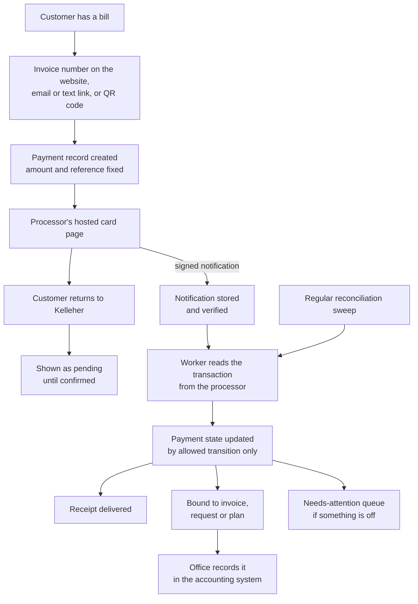
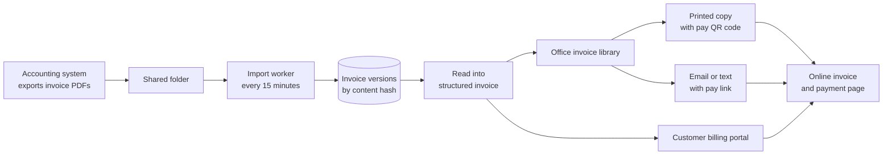

# Kelleher HVAC: architecture

This page goes one level deeper than the [README](../README.md). It covers how the platform is divided, how money and documents move through it, how people and AI agents are allowed in, and how the work is checked. Nothing here is product code. Where a shape is shown, it has been rewritten for this page.

## 1. One application, three faces

The platform is a single Next.js 16 application with one PostgreSQL database. It answers on separate hostnames, and each hostname serves only its own part:

| Face | Who uses it | What it holds |
|---|---|---|
| Public site | Homeowners, search engines | Marketing pages, services, service areas, blog, careers, financing, contact and enquiry form, the website assistant, and the customer billing portal (customers sign in with an emailed link) |
| Payment pages | Anyone with a bill | Pay by invoice number, payment-request links, invoice pages reached from a QR code, maintenance-plan offer pages, receipts. No account and no sign-in are needed to pay. |
| Staff admin | Office staff and owners | Customers, invoices, payments, payment requests, campaigns and mailings, operations records, content management, team and settings, the staff Assistant |

A request for a page that belongs to another face is redirected or turned away rather than served. Signed-in write requests are refused unless they come from the platform's own pages. Staff pages are never cached, and sign-in, payment-link and offer pages are kept out of search indexes.

Behind the three faces sit domain modules (payments, invoices and billing, offers and mailings, operations, content, team and access, assistants). Pages, admin actions and the public API all call the same modules, so each business rule has exactly one home.

## 2. Getting paid

**The card never touches Kelleher.** Card entry happens on Authorize.net's hosted page. The platform sends the amount, the payer's details, the invoice number and its own reference, so the processor's records carry the invoice number the office already uses.

**Evidence decides the state.** A payment has an explicit state machine: created, session ready, pending, unknown, held, accepted, settled, declined, voided, settlement failed, partially refunded, refunded. Each state lists the states it may move to, and every move checks the record's version and stores the evidence behind it. Signed notifications are checked against the original request bytes, and the worker then reads the transaction from the processor before anything changes. A regular sweep of the processor's transaction reports catches anything a notification missed. A customer coming back from the card page is shown "pending" until the processor's own records agree.

**One answer to "does this need a person?"** A single module decides which payments need the office: checkouts left unresolved past the hosted page's time limit, failed settlements, voids and refunds, disagreements found during reconciliation, settlements still missing after two business days, and refunds on payments already recorded in the accounting system. The queue, the payment page and the dashboard count all read that one definition. When someone resolves an item, it clears everywhere at once.

**Recording in the accounting system.** Kelleher's books stay in its existing accounting system. The admin keeps a list of web payments still to be recorded there. Each recording is a tracked, idempotent action, so a double click or a retry can't record the same payment twice.

**Payment history.** The customer page also shows each customer's earlier card history from the processor, synced into the platform. Staff can see the whole relationship, not just payments made since launch.

## 3. Invoices: from the accounting system to the customer

- **Import.** A packaged worker scans the source folder on a schedule, with a "check now" button for staff. It takes a fenced lease, works in bounded steps, saves its list of pending files before downloading anything, and has hard caps on how much it scans in one run. Files are identified by a SHA-256 hash of their content. Identical bytes are recorded as another sighting of the same file. Different bytes become a new revision and never silently replace the version a customer has already seen. One bad document is set aside and retried, and the rest of the import continues.
- **Reading.** Invoice PDFs are parsed into structured line items, totals and notes, with the formatting conventions of the source documents turned into clean typography. Staff can always open the original PDF beside the structured view.
- **Delivery.** Staff choose which invoices to send, when and how. A printed copy carries its own QR code. Email and text messages carry a link. Every route opens the same invoice page, which shows what is owed and hands off to the hosted card page. Text messages respect recorded consent and opt-outs, and delivery attempts, bounces and complaints are kept separately from payment records. Sending a bill never counts as payment.

## 4. Offers and mail

Maintenance-plan campaigns turn a list of households into personalised letters:

1. Staff import a candidate list, choose a campaign and set its terms.
2. Each offer renders a one-page US-letter PDF with a QR code for that household's own offer page.
3. The verifier reads the actual PDF bytes. It checks the page count, size and fonts, rasterizes the page, decodes the QR code and requires an exact match with the offer's address. It also checks that nothing is printed where the mail house stamps the address.
4. Approval is a state transition with named preconditions. A document that hasn't passed can't be approved, and a live mailing batch can only be approved by a person, never by an API key.
5. A test-mode batch gets real proofs back from PostGrid without posting anything. A live batch posts only when someone runs the queue. Before any letter is marked failed or cancelled, the platform asks PostGrid what actually happened.

Plan purchases and renewal bills run through the same hosted card page and payment state machine as every other payment.

## 5. Operations data and the agent API

The operations model covers customers and contacts, service sites, equipment, jobs, assignments, visits, checklists and procedures, evidence uploads, visit close-out and amendments, follow-ups, part requests and permits. It is the foundation for moving day-to-day field work onto the platform.

All of it is exposed through a versioned API:

- **146 operations**, described in an OpenAPI document generated from the server's own registry, with a viewer inside the admin.
- **Scoped keys.** Each AI agent workspace gets its own key with named permissions (for example `customers:read` or `jobs:write`). Keys are shown once, stored only as hashes, and can be rotated or revoked. Managing keys requires a signed-in person, never a key.
- **Safe writes.** Writes accept idempotency keys, and a change feed lets an agent catch up on what changed since it last looked. Errors come back in one shared format.
- **Task guides.** Agents read plain-language guides for each area of work (getting started, customers and assets, jobs and visits, evidence and close-out, permits, offers and mailings, payments). A build step checks the guides against the specification. It fails on a link to an operation that doesn't exist, a wrong permission name, or an example request the API would reject.

Emergent's agents work through this API from [NextAgent](https://github.com/codeslayer44/nextagent-showcase). Because people and agents call the same services, a change made by an agent obeys exactly the same rules as one made in the admin.

## 6. People and access

- **Customers** sign in to the billing portal with a short-lived emailed link. There is no customer password and no self-service sign-up. Paying never requires signing in.
- **Staff** are invited from the Team screen and sign in with a password or an emailed link. Access is set person by person as capabilities (operations, invoices, payments and reporting, content, team, and so on), and every admin page and route checks the capability it needs.
- **Technicians** have their own account type, built for the upcoming iPhone app. It comes with its own access rules and an audit log, and stays behind a switch until the app is ready.

## 7. The assistants

Both assistants share one core: a turn runner that calls an LLM through OpenRouter, streams the answer, keeps transcripts and records each tool call. Each has its own on/off switch and model setting in the admin.

| | Website assistant ("Ask Kelleher") | Staff Assistant |
|---|---|---|
| Sees | A knowledge pack built from the public site's own copy, each fact tagged with its page | Notes about each admin page, the pages this person is allowed to open, and the page they are on |
| Can do | Search articles, suggest a page, offer the enquiry form | List destinations, open a page |
| Never sees | Customers, invoices, staff, campaigns, or anything not already public; a filter removes topics the business keeps off the site | Any customer, invoice, payment or enquiry data |
| Enforced by | The content filter, plus a verify suite that pins what the knowledge pack contains | A verify suite that fails if the tool list grows or any assistant code imports a data service |

## 8. Search and the old website

The public site replaced a WordPress site. The migration was handled as a search problem, not a design one:

- Every URL Google Search Console reported for the old site (222 of them) is checked against production by a script. Each old page loads or redirects to its new home. Old upload paths and unknown addresses return a real 404, not a "soft" one.
- 24 blog posts from the old site were recovered from the Internet Archive and restored at their original addresses.
- Each page carries business structured data, breadcrumbs, a canonical URL and one heading. A rendered-page check confirms all of this for every URL in the sitemap.
- The six main service areas have their own pages and FAQs, and photos are served at sizes suited to phones.

## 9. How the work is checked and shipped

- **Verify suites.** 110 suites, almost all TypeScript, cover the platform (four more cover fleet code that has since moved to [FleetHarbor](https://github.com/codeslayer44/fleetharbor-showcase)). Together they run to more than 10,000 assertions. They exercise real database behaviour against throwaway fixture databases: state transitions, races, idempotency, access rules, rendered pages, generated PDFs and email text. The suites that touch money refuse to run against anything but a local test database, refuse if processor credentials are present, and disable the network.
- **Build gates.** The production build fails if the API manifest, the agent guides or the agent client drift from the server's specification.
- **Releases.** Every change lands as a pull request. Production releases ship from the main branch, take a database backup first and are followed by live checks of health, key pages and access boundaries. Risky behaviour ships behind a switch that can be turned off with a restart, without a redeploy.
- **Hosting.** The app and its background workers ship together as one release on [HostKit](https://github.com/codeslayer44/hostkit-showcase). The workers are bundled into the build and scheduled by the host. Each runs under a supervisor that stops it if it overruns, and the long-running ones hold a lease so two copies never work on the same thing.

## 10. Related projects in the engagement

- **Technician iPhone app** (early development). A SwiftUI app for iOS 18 and later. Its plan is to embed the platform's existing screens and handle voice, camera and location natively. Today it is a simulator-only foundation: a native voice-report tab with honest "not submitted" status, and a clearly labelled embedded preview. The platform side has technician accounts, access rules and an audit log ready behind a switch.
- **Accounting data access** (built and tested in simulation, not yet in use). A one-time setup that will let Emergent read business data from Kelleher's existing accounting system, read-only. It inventories before it changes anything, shows a dry run, asks for explicit confirmation and has an undo that reverses only what it set up. It stops instead of overriding anything it didn't install itself.
- **HVAC manual library** (specified, research under way). A separate service that will catalogue HVAC equipment manuals back to model year 2000. Given an identified unit, it will return the applicable manual sections, tables and pages with exact citations. Kelleher's platform will be its first consumer, calling it server-side. So far the work is a detailed specification and an early, sourced inventory of manufacturers and brands. Implementation has not started.
